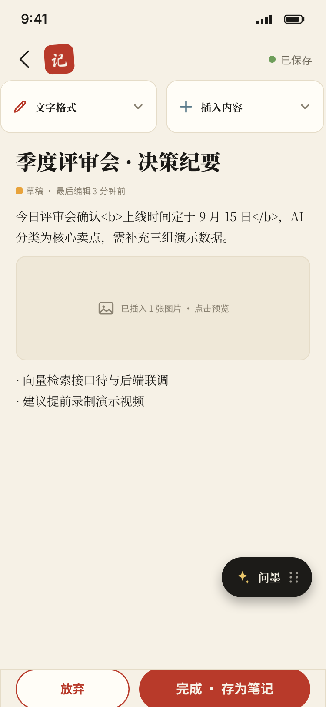
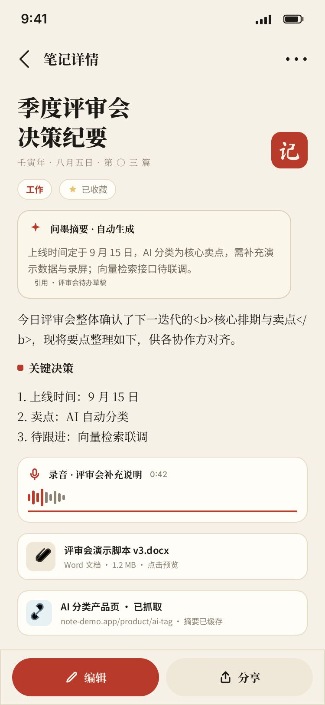
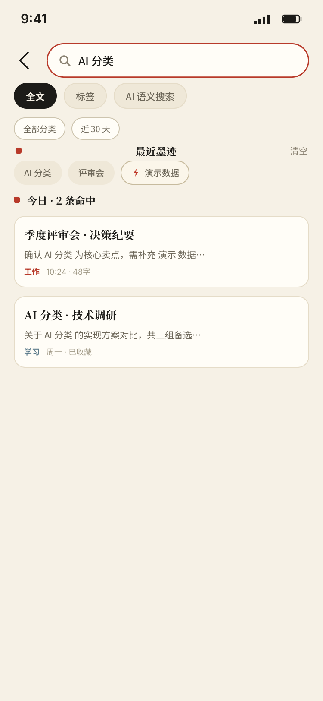
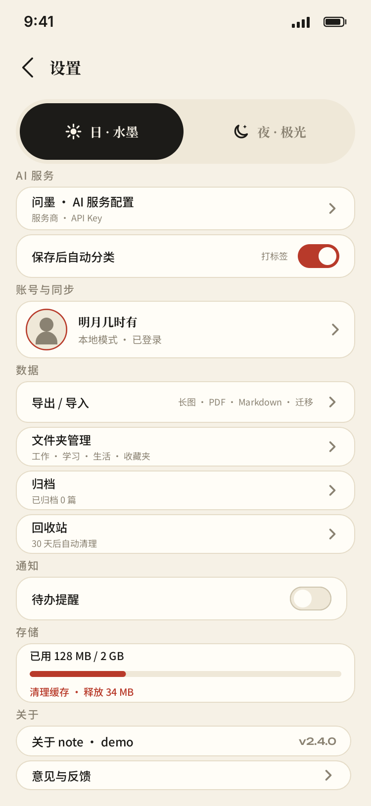

<div align="center">

# note-demo · 问墨

**AI 智能笔记助手 —— 把「记录」和「整理」交给一句话**

「水墨为体 · 纸间为用 · 极光为夜」

[](https://reactnative.dev/)
[](https://expo.dev/)
[](https://www.typescriptlang.org/)
[](https://docs.expo.dev/versions/latest/sdk/sqlite/)
[](./LICENSE)

</div>

---

## 📖 项目简介

**note-demo（中文名「问墨」）** 是一款基于 **React Native + Expo** 的移动端 AI 笔记应用。它把「随手记」和「事后整理」两件事合成一件：

- **记** —— 文字、拍照、录音、附件、网页链接、待办，全部收进同一个入口，点一下中央的「＋」就能速记。
- **理** —— AI 自动为每条笔记分类、打标签、生成摘要，并基于你的**本地笔记**做 RAG 问答（「问墨」），让「我记过什么」变成一个可以对话的问题。

全部数据保存在**设备本地 SQLite**，AI 能力通过用户自填的 API Key 直连，不经过任何中间服务器。

> 项目定位为个人全栈实践：从需求 → 数据模型 → 交互设计 → 前端实现 → 文档沉淀，独立完成并持续迭代。

---

## ✨ 功能亮点

| 模块 | 亮点 |
|---|---|
| **手帖（笔记列表）** | 每日长卷 / 日历 / 图库三视图切换；scroll-snap 吸附横向卷轴；多模态卡片（文字·语音声波·图片·链接） |
| **编辑器** | 富文本（加粗/变色/插图片）；自动保存（防抖 2s + 状态指示）；拖入图片；内置 AI 润色快捷操作 |
| **问墨（AI 对话）** | SSE 流式对话、多会话、引用溯源；基于本地笔记的 **RAG** 作答；语义搜索 |
| **AI 自动整理** | 自动分类 + 打标签 + 生成摘要；结果进入「待确认」队列，可逐条确认或修改，支持一键全部确认 |
| **待办** | 今日三事 / 近 7 天 / 收集箱；优先级三档、关联笔记、**系统通知提醒**（datetimepicker 排期） |
| **链接库** | 分享到 App 自动入库（Share Target 深链）；URL 失焦自动抓取预览；独立标签表与标签筛选 |
| **全局截屏** | 自定义原生模块 + MediaProjection 抓帧，存为敏感图片笔记（默认不进 AI、不导出） |
| **搜索** | 全文 / 标签 / AI 语义 三模式；分类 + 时间筛选；搜索历史；命中词描金高亮 |
| **双主题** | 日间「水墨 SUMI」（宣纸白/焦墨黑/朱砂红）与夜间「极光 AURORA」（深空黑/毛玻璃/极光渐变），跟随系统或手动切换 |
| **导出** | 一键把全部笔记/待办导出为 Markdown 并拉起系统分享 |

---

## 🏗 技术栈

| 层级 | 选型 |
|---|---|
| 框架 | React Native 0.86 + **Expo SDK 57**（expo-router 文件式路由） |
| 语言 | TypeScript 5 |
| 状态管理 | Zustand |
| 本地存储 | **expo-sqlite**（WAL、迁移、LIKE 全文检索） |
| 富文本 | react-native-pell-rich-editor |
| 语音 | expo-audio（录音）；ASR 转写预留 |
| AI | 通义千问 / DeepSeek（SSE 流式、RAG、自动分类/标签/摘要） |
| 动画 | RN Animated 自建动效模块（入场交错、印章脉冲、声波律动…） |
| 图标 | react-native-svg（自建 43 枚 `NoteIcon` 线标） |
| 原生模块 | 自写 Expo Module `modules/screen-capture` + Config Plugin `plugins/withNoteDemoNative.js` |

---

## 📂 项目结构

```
note-demo/
├── app/                    # expo-router 路由（25 个页面）
│   ├── _layout.tsx         # 根布局：数据库初始化 / 主题 / 浮层 Provider
│   ├── tabs/               # 底部导航：手帖 / 问墨 / 待办 / 设置
│   ├── note/               # 笔记 新建 / 详情 / 编辑
│   ├── todo/[id].tsx       # 待办详情 / 新建 / 编辑
│   ├── search.tsx          # 搜索（全文 / 标签 / AI 语义）
│   └── ...                 # 收藏 / 回收站 / 文件夹 / 链接库 / 引导 …
├── services/               # 服务层
│   ├── db/                 # database.ts（初始化 + 串行化 + 迁移）、schema.ts
│   ├── note / folder / category / tag / todo .service.ts
│   ├── attachment / voice / search / savedLink / notification .service.ts
│   └── ai/                 # AI 客户端（qwen/deepseek）、SSE、RAG、自动分类
├── stores/                 # Zustand（note / ai / todo / settings / homeView）
├── src/
│   ├── components/         # 通用 / 笔记 / 待办 / 创作浮层 / AI / 编辑器组件
│   ├── theme/              # 双主题令牌（SUMI / AURORA）
│   ├── animations/         # 自建动效 hooks
│   ├── constants/ hooks/ utils/
│   └── ...
├── modules/screen-capture/ # 自写 Expo 原生模块（截屏抓帧）
├── plugins/                # Expo Config Plugin
└── docs/                   # 全套项目文档（需求/架构/数据/API/UI/测试/部署）
```

---

## 🖼 界面预览

> 设计稿见 [`docs/UI/`](docs/UI/)（日间 `2_*.png`、夜间 `night-final/3_*.png`）

| 手帖（笔记列表） | 问墨（AI 对话） | 编辑器 | 设置 |
|---|---|---|---|
|  |  |  |  |

---

## 🚀 快速开始

```bash
# 1. 安装依赖
npm install

# 2. 启动开发服务器
npx expo start

# 3. 运行
npx expo start --android     # Android
npx expo start --ios         # iOS（或用 Expo Go 扫码）
```

**配置 AI**：进入「设置 → AI 服务」，填入通义千问 / DeepSeek 的 API Key（存于 `expo-secure-store`，仅本地保存）。

> **原生能力提示**：语音录音基于 `expo-audio`（Expo Go 已内置）；系统通知提醒与全局截屏依赖自定义原生模块，需使用开发构建：
> `npx expo run:android` / `npx expo run:ios`（Expo Go 下会自动静默降级）。

---

## 📚 项目文档

工程文档完整收录于 [`docs/`](docs/)，含需求规格、技术架构、数据模型、API 设计、UI 交互规范、测试方案、部署指南等，可作为同类项目的设计与开发参考。

---

## 🗺 路线图

- [x] **v0.1（MVP）** 核心闭环：编辑器 / 详情 / 搜索 / 设置 / 待办详情 / 引导
- [ ] 语音实时转写（ASR 接入）
- [ ] 云端同步与多端一致性
- [ ] AI 能力扩展（自动周报、笔记关联图谱）

---

## 📄 License

本项目基于 [MIT License](./LICENSE) 开源。

> Author: **[@minqi816648-jane](https://github.com/minqi816648-jane)**
